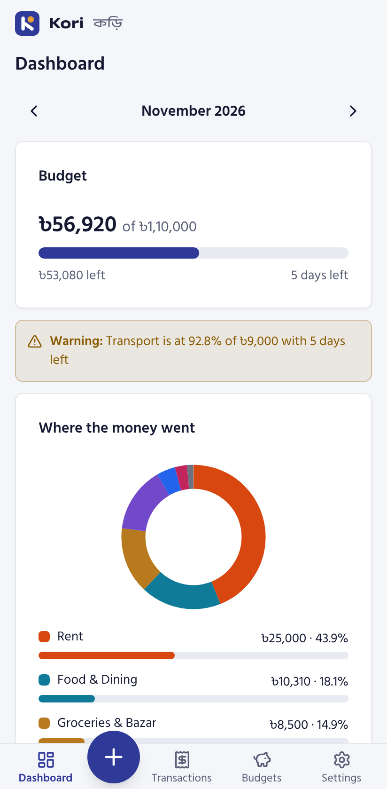
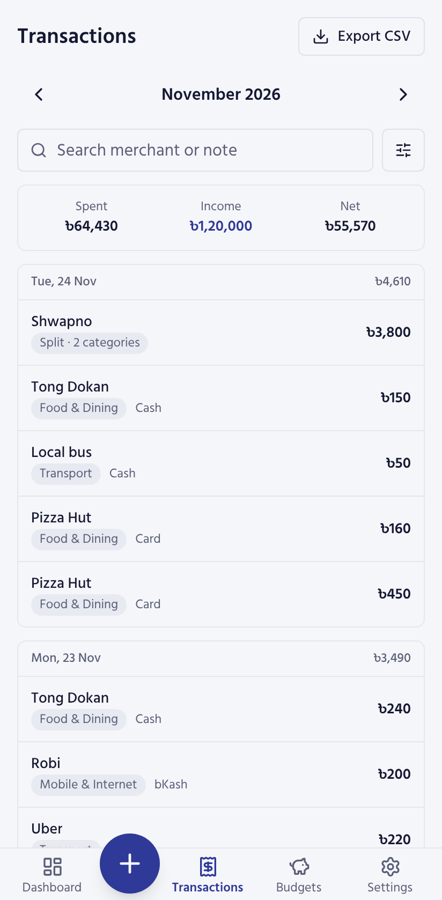
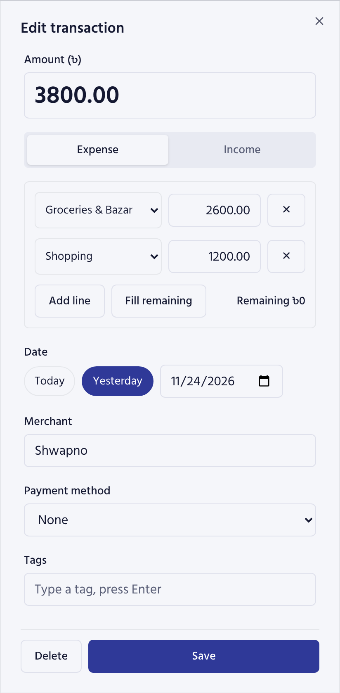
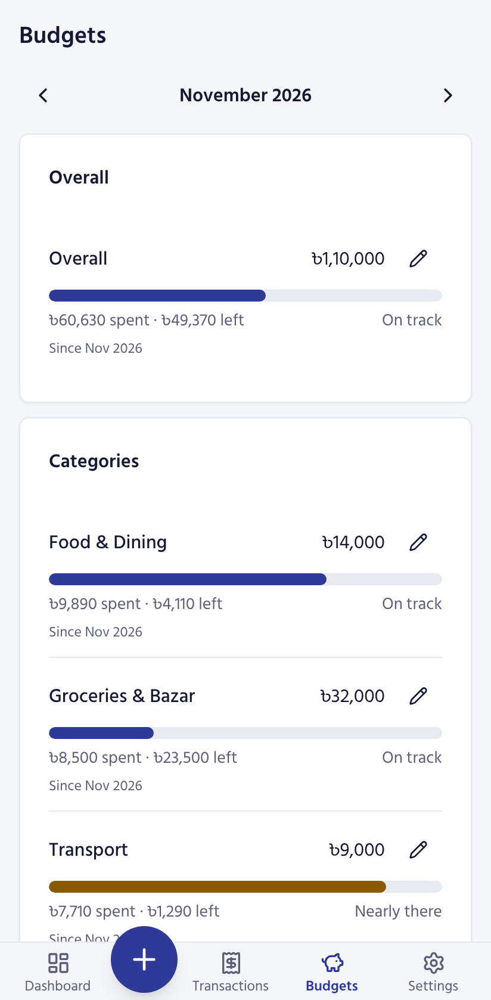
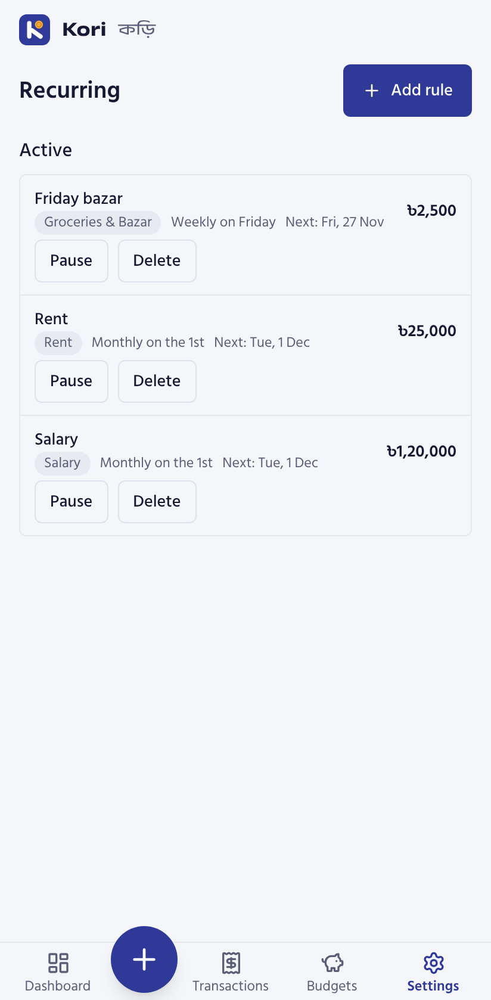
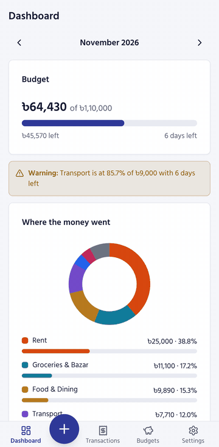
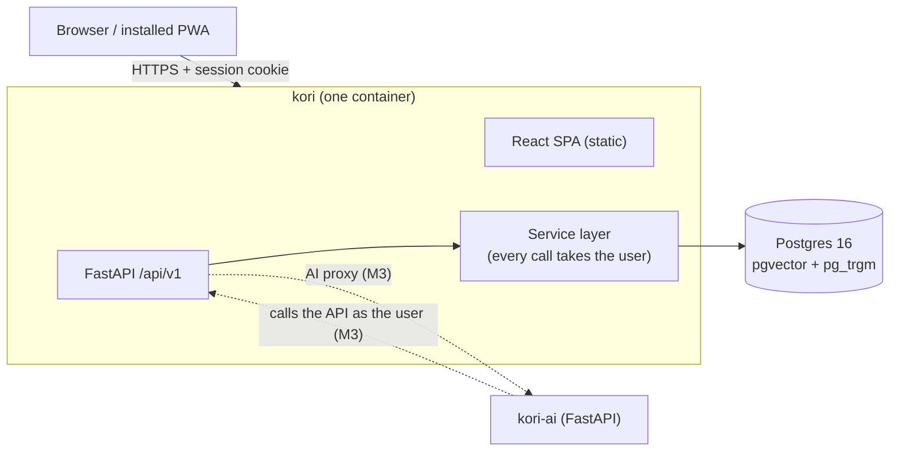

# Kori (কড়ি)

[](https://github.com/monjurul0007/kori/actions/workflows/ci.yml)
[](https://github.com/monjurul0007/kori/actions/workflows/deploy.yml)
[](LICENSE)

**A personal expense and budget app that grows into an AI assistant.**
It's named after the cowrie shells (কড়ি) once used as money in Bengal.

> **Status: pre-alpha.** Milestones 1 ("Log it, live") and 2 ("Plan it") are code-complete; every
> merge deploys to free-tier hosting ([runbook](docs/deploy.md)). See the [roadmap](ROADMAP.md)
> and the [changelog](CHANGELOG.md).

<p align="center">
  
  
  
  
  
</p>

<p align="center">
  
</p>

<sub>Screenshots and the GIF come from the fake demo seed data. Regenerate them with
`pnpm screenshots` ([how](apps/web/e2e/screenshots.ts)).</sub>

## Why Kori

- **Daily use.** I track my spending in BDT (cash, bKash, cards) and want a fast, private tool that
  works well on my phone.
- **An AI-engineering lab.** Over time Kori will answer questions about my money, take actions on my
  behalf (always with my confirmation), and surface insights in the background. Each capability is
  built in stages and measured with evals.
- **Built properly.** Small reviewed PRs, tests against a real Postgres, CI on every change, and
  written architecture decisions.

## Features

| Milestone | What you get |
|---|---|
| **M1 · Log it, live** ✅ | Login, fast expense and income entry on phone (installable PWA), split transactions and tags, a monthly list with totals and search, and deployment on free-tier hosting |
| **M2 · Plan it** ✅ | Monthly budgets with warnings, a dashboard (budget status, spending by category, six-month trend), a split editor, recurring rules, CSV export, and PWA polish (install prompt, update toast, offline shell) |
| **M3 · AI seams** | The contract and auth between Kori and `kori-ai`, an assistant panel, quick-add, confirmation cards, an insights card |
| **M4–M8 · AI track** | Natural-language entry, Q&A over my data using tools, an agent with confirmed actions, auto-categorization and anomaly alerts, evals and tracing |

See [ROADMAP.md](ROADMAP.md) for the full plan.

## Architecture at a glance



Kori owns the financial data. The AI service is only a client of Kori's API: it acts **as the
logged-in user**, so it can never see or change more than the user can. Details are in
[docs/architecture.md](docs/architecture.md).

## Repositories

| Repo | Purpose |
|---|---|
| **kori** (this repo) | Web app (React) and API (FastAPI), plus the database migrations, infrastructure and docs |
| [**kori-ai**](https://github.com/monjurul0007/kori-ai) | The AI service: parsing, Q&A, agent, background insights (stubs until M4) |

## Tech stack

| Layer | Choice |
|---|---|
| API | Python 3.12, FastAPI, SQLAlchemy 2, Alembic, Pydantic v2, uv |
| Database | Postgres 16 with pgvector and pg_trgm |
| Web | React, TypeScript, Vite, TanStack Query, Tailwind CSS with shadcn/ui, installable PWA |
| Quality | pytest against real Postgres, Vitest, React Testing Library, Playwright; ruff, mypy, ESLint |
| Delivery | Docker, GitHub Actions, GHCR, free-tier hosting (see spike S2) |

The reasoning behind each choice is in [ADR-0002](docs/adr/0002-tech-stack.md).

## Getting started

Needs Docker. This builds the production image and starts it with Postgres:

```bash
git clone https://github.com/monjurul0007/kori.git && cd kori
cp apps/api/.env.example apps/api/.env
make up                                          # http://localhost:8000, migrations applied
make create-user email=you@example.com name="You"
make seed                                        # optional: fake demo data (needs uv)
```

`make down` stops it and `make logs` follows the app logs. For development with hot reload, see
[CONTRIBUTING.md](CONTRIBUTING.md).

## Project docs

- [ROADMAP.md](ROADMAP.md): milestones and their status
- [docs/architecture.md](docs/architecture.md): components, principles and the planned data model
- [docs/adr/](docs/adr/README.md): architecture decision records
- [CONTRIBUTING.md](CONTRIBUTING.md): branching, commits, PR rules and the definition of done

## How this project is built

I own the product and review every PR. Implementation is pair-programmed with an AI coding agent
(currently Claude Code):
- The backlog lives on a Trello board.
- Each task card becomes one small, focused PR, following [CONTRIBUTING.md](CONTRIBUTING.md) and
  [AGENTS.md](AGENTS.md), the tool-agnostic rules every AI agent follows.
- I build the AI features (M4–M8) myself, as part of moving into AI/ML engineering.

## License

[MIT](LICENSE) © 2026 Monjurul Hoque
